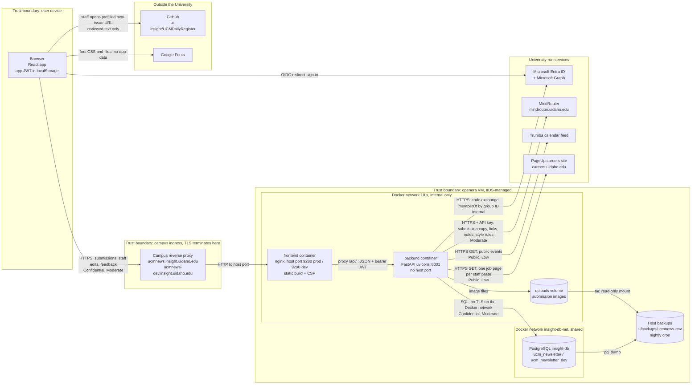
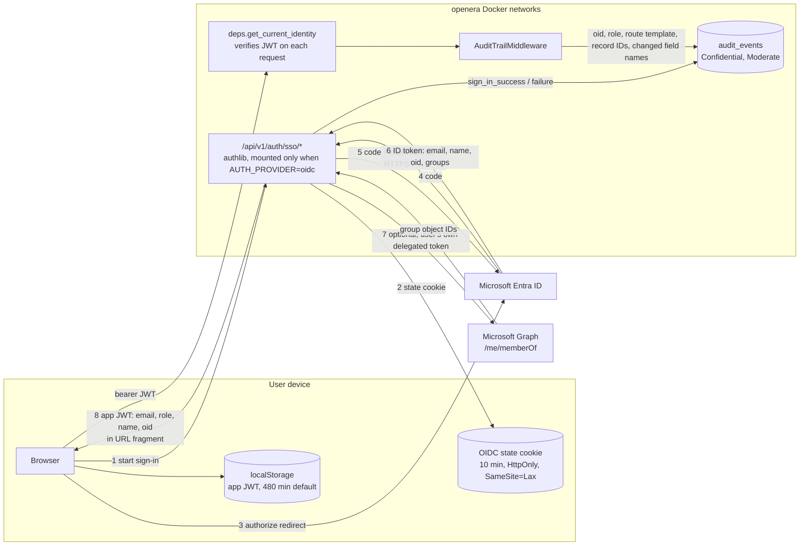
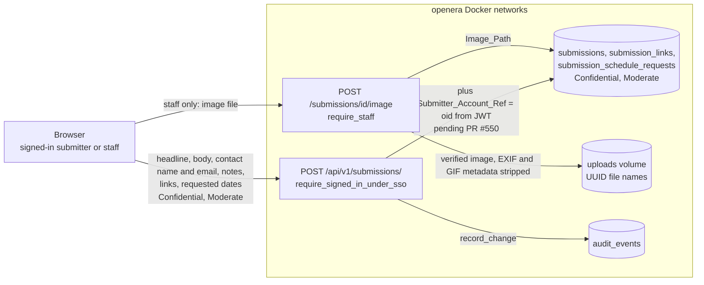
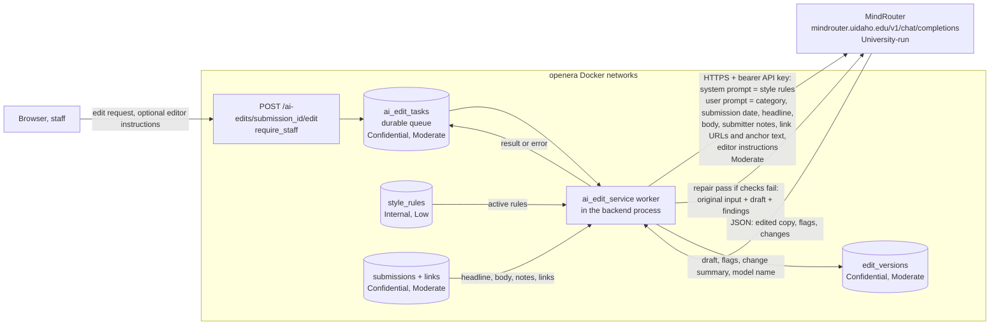
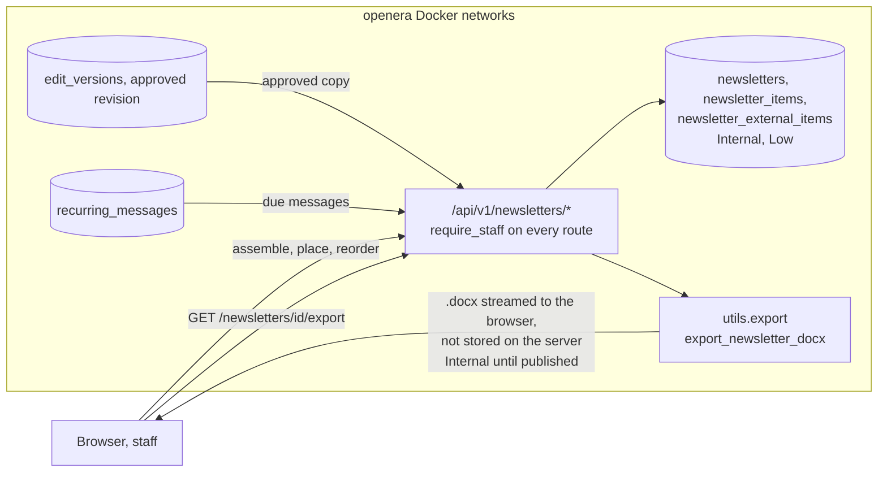
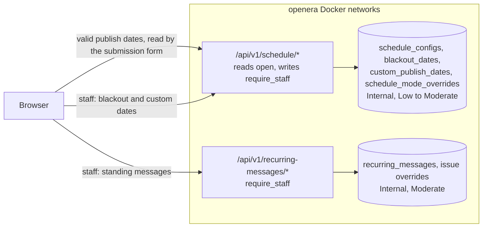
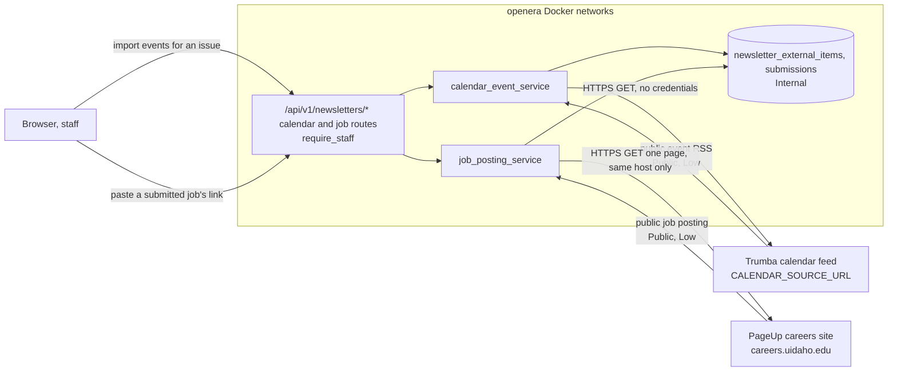
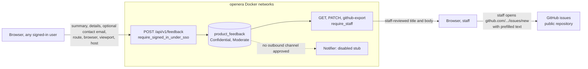
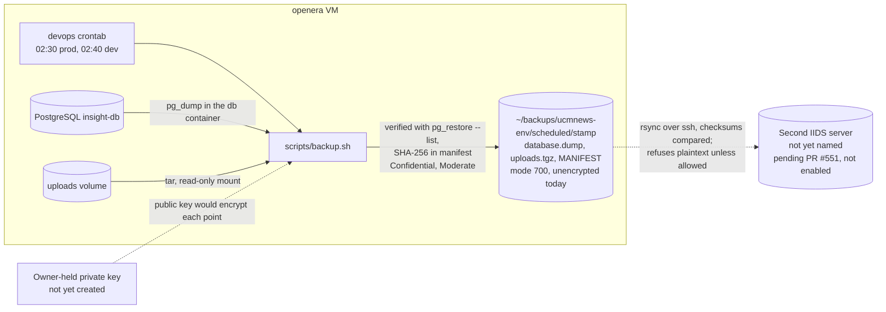

# Data Flow Diagrams

Prepared for the OIT security review (see [OIT Security Review Prep](../oit-security-review-prep.md)).
Checked against the code on `main` at `52d156d` (2026-11-20). Two changes
pending merge are marked where they apply:

- **PR #550:** `submissions.Submitter_Account_Ref`, the Entra object ID of the
  account that sent each submission.
- **PR #551:** an opt-in off-host copy of backups to a second IIDS server. Not
  enabled.

Handling labels (Public / Internal / Confidential) come from
[Data Governance](../data-governance.md). APM 30.11 tiers come from the
[governance catalog](../governance/data-dictionary.md). The tiers are
**proposed** (issue #176) until the Data Owner approves them. The application
as a whole is proposed **Moderate**.

What is in scope: the newsletter app as deployed on dev and prod. The SLC
calendar harvest and the Ops needs classifier are retired. Their API routes are
not mounted (`backend/app/api/v1/router.py`) and the SLC harvest cron lines on
openera have been commented out since 2026-11-03. Their code and tables stay
until the Phase 2 removal exports the data. They are listed in
[Retired flows](#retired-flows) and are not drawn.

## 1. System context

Notes:

- Only the frontend container publishes a host port. The backend and database
  are reachable only on Docker networks (`docker-compose.yml`).
- Encryption in transit: browser to campus ingress is HTTPS. Ingress to the
  nginx host port, nginx to the backend, and the backend to PostgreSQL are
  plain HTTP/SQL inside the VM. Backend calls to Entra, Graph, MindRouter,
  Trumba and PageUp are HTTPS.
- nginx sends a Content Security Policy (`frontend/nginx.conf`) that allows
  scripts and API calls only from the app's own origin, fonts and font CSS from
  Google Fonts, and `frame-ancestors 'none'`.
- No email, SMTP, Teams or webhook path exists. The feedback notifier is a
  disabled stub (`FEEDBACK_NOTIFICATION_CHANNEL` only accepts `disabled`).

## 2. Sign-in, session tokens and audit trail

| Item | Detail |
| --- | --- |
| Data stores | `audit_events` (append-only by convention). Browser localStorage holds the app JWT; the Entra token never reaches the browser. |
| External entities | Microsoft Entra ID, Microsoft Graph (only when `OIDC_GROUP_SOURCE=graph`). |
| Crosses boundaries | Browser ↔ Entra: OIDC redirect. Backend ↔ Entra: code exchange with client secret. Backend → Graph: group IDs for the signed-in user. Backend → browser: signed app JWT. |
| Controls | Roles mapped from Entra group **object IDs**, not display names (`graph_groups.py`). Graph pagination is restricted to `graph.microsoft.com`. JWT verified per request; an invalid or expired token is a 401, never a silent drop to the public role. Tokens are honored only under `AUTH_PROVIDER=oidc`. Audit rows store the `oid`, not email, and no content, query strings, IPs or user agents ([Audit Logging](../audit-logging.md)). |
| Gaps | No server-side session revocation: a JWT stays valid until it expires. The audit table is in the app database, not an off-host or tamper-evident store. |

## 3. Submission intake

| Item | Detail |
| --- | --- |
| Data stores | `submissions`, `submission_links`, `submission_schedule_requests`, uploads volume. |
| External entities | None. |
| Crosses boundaries | Browser → backend only. |
| Controls | Under SSO everyone signs in before submitting (ADR-002). Category, recurrence and "repeat indefinitely" options are checked against the caller's role server-side. Listing, detail, edit, delete and image read are `require_staff`. Non-staff list responses redact PII. Image upload is staff-only. Every write is an audit event. Pending PR #550: the submitting account's `oid` is stored from the token, never the request body, and is not returned by any API. |
| Gaps | Free-text fields can hold personal information the submitter typed; nothing strips it. |

## 4. AI editing pipeline

| Item | Detail |
| --- | --- |
| Data stores | `ai_edit_tasks`, `edit_versions`, `style_rules`. |
| External entities | MindRouter (the only provider; `LLM_PROVIDER` accepts only `mindrouter`). |
| Crosses boundaries | Submission copy, submitter notes, link URLs with their query parameters, and editor instructions go to MindRouter. Email-gateway wrapped links (Proofpoint, Safe Links, Mimecast, Barracuda) are unwrapped locally first; no request is made to resolve them. |
| Not sent | The `Submitter_Name`, `Submitter_Email`, `Assigned_Editor` and `Editorial_Notes` columns are not put in the prompt (`prompts.build_edit_user_prompt`). Personal information typed into the copy or notes is sent as is. |
| Controls | Staff-only trigger. HTTPS to MindRouter with an API key from the environment file. Bounded concurrency and queue size (`AI_EDIT_MAX_CONCURRENCY`, `AI_EDIT_MAX_PENDING`). Logs record model and character counts, not content. Anthropic and OpenAI were removed on 2026-11-20. |
| Gaps | No recorded approval reference for MindRouter as the AI processor, or for its retention terms. Configurable endpoint URLs alone do not prove campus-only routing. |

## 5. Newsletter builder and Word export

| Item | Detail |
| --- | --- |
| Data stores | `newsletters`, `newsletter_items`, `newsletter_external_items`. |
| External entities | None from the server. Staff take the .docx to the publishing process outside this app. |
| Controls | Every builder and export route is `require_staff`. Contact columns and internal notes are not exported; contact details written into the copy are. Export downloads are audit events. |
| Gaps | Downloaded .docx files on staff devices are outside the app's controls. |

## 6. Schedule and recurring messages

| Item | Detail |
| --- | --- |
| Data stores | Schedule tables, `recurring_messages`, `recurring_message_issue_overrides`. |
| External entities | None. |
| Controls | Schedule GET routes have no auth dependency so the submission form can show valid dates; they return publication calendars, not submissions. All writes and all recurring-message routes are `require_staff`. |
| Gaps | `custom_publish_dates.Description` and `schedule_mode_overrides.Description` are free text tagged Moderate but served by the open GET routes. Confirm they never hold non-public notes, or put the read behind sign-in. |

## 7. Calendar events and jobs (inbound public reads)

| Item | Detail |
| --- | --- |
| Data stores | `newsletter_external_items`; calendar events can also be turned into submissions. |
| External entities | Trumba, PageUp careers site. |
| Crosses boundaries | Outbound: GET requests with no credentials or user data. Inbound: public event and job text. |
| Controls | Staff-only, on demand, no scheduled fetch. Job links must be `https` on the configured careers host, and redirects off that host are refused. 10-second timeouts. The careers site's throttling response is handled with a back-off. |
| Note | The default `CALENDAR_SOURCE_URL` in `config.py` points at `www.qatrumba.com`, and as of 2026-11-20 the prod environment file does not override it, so prod reads from that host. Whether it should read from the production Trumba host is an open decision. |

## 8. Feedback

| Item | Detail |
| --- | --- |
| Data stores | `product_feedback`. Export records keep a SHA-256 of the reviewed text and the review time, not a second copy. |
| External entities | GitHub, reached by the staff member's browser, not by the server. |
| Controls | Only reviewed text is prepared for export. The server never calls GitHub. The notifier cannot send. |
| Gaps | The GitHub repository is public. Anything staff leave in the reviewed text is published, and the prefilled URL itself carries the text to GitHub. |

## 9. Backups

| Item | Detail |
| --- | --- |
| Data stores | One directory per run on openera. Nothing is pruned. |
| External entities | None today. Planned: a second IIDS server (PR #551). |
| Controls | `umask 077`, directories mode 700, archive readability and schema-version check, checksums, freshness check (`--check`, 26 hours). GPG encryption support exists but is off until an owner-held key is created. |
| Gaps | Backups are on the same VM as the database and unencrypted. No failure alerting. Environment files (secrets) are not backed up. Prod restore not yet tested in an isolated environment; dev restore passed 2026-11-03. See [Backup & Recovery](../backup-and-recovery.md). |

## Retired flows

Not mounted on dev or prod; code and tables kept until Phase 2 removal.

| Flow | What it did | State |
| --- | --- | --- |
| SLC calendar harvest | Read the Trumba JSON feed into `harvested_events`; SLC users flagged events | Routes unmounted; cron lines paused since 2026-11-03 |
| Ops needs classifier | Sent event title, description (up to 4,000 characters), location and category to MindRouter; stored needs and rationale in `ops_need_assessments` | Routes unmounted; runs only as part of a harvest, which is paused |

## Gaps visible in these flows

1. Backups stay on openera, unencrypted, until an encryption key exists and the
   second IIDS host is set up (PR #551 adds the copy step; not enabled).
2. No recorded approval reference for MindRouter as the AI processor.
3. Data classification and APM 30.11 tiers are proposed until the Data Owner
   reviews them (issue #176).
4. Traffic inside the VM (ingress to nginx, nginx to backend, backend to
   PostgreSQL) is not encrypted.
5. No server-side session revocation; the audit trail is not off-host.
6. Free text from submitters goes to MindRouter without automatic removal of
   personal information.
7. Staff-prepared feedback exports go to a public GitHub repository.
8. Fonts load from Google, so browsers contact Google on every page load.
